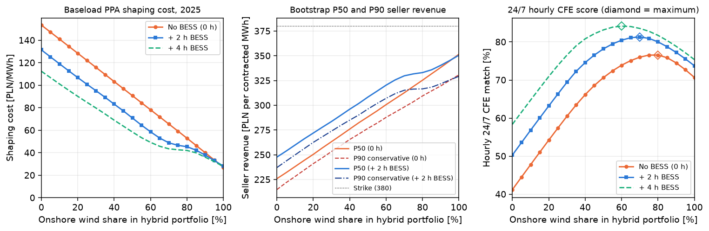
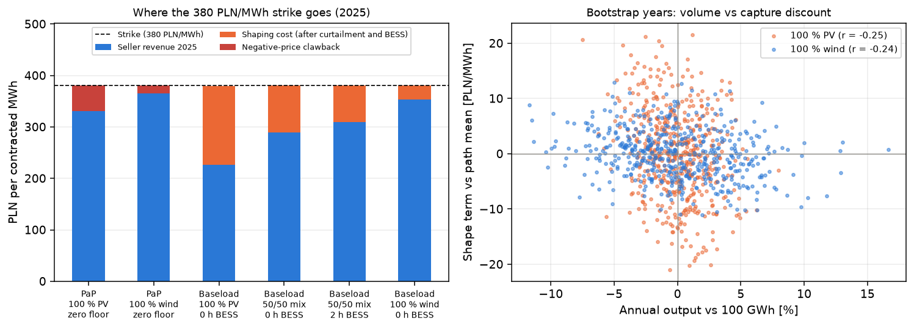
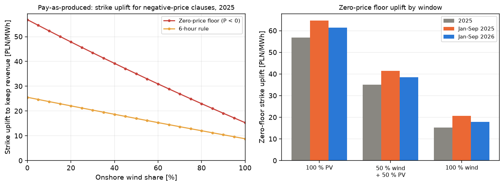
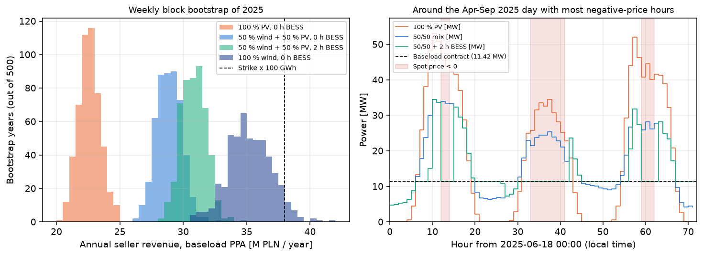

# Corporate PPA structuring and shaping risk on Polish power prices

[](https://github.com/kwwaleszczynski-del/pl-cppa-shaping-risk/actions/workflows/ci.yml)

When an industrial electricity buyer in Poland signs a corporate power purchase agreement (cPPA), the first decision
is who holds the profile risk between variable renewable output and the factory's consumption schedule. A
**pay-as-produced (PaP)** contract settles on the generator's meter and leaves the buyer with the shape; a
**baseload or profiled CfD** fixes the buyer's hedge on its load schedule and leaves the seller to buy the hours it
does not produce and sell the hours it overproduces. This project measures what that costs, hour by hour, on public
Polish data:

1. **Data.** PSE's RCE price and the national PV and wind output (PSE `his-wlk-cal`) for 1 January 2025 to
   30 September 2026, averaged to hours. 2025 is the reference year; PV and wind profiles are scaled so that each
   delivers the contract volume (`100 GWh/yr`).
2. **Contracts.** A `100 GWh/yr` contract at a fixed strike `S = 380 PLN/MWh` (an illustrative value, not a market
   quote) against three buyer schedules: flat baseload (`11.42 MW`), two-shift industrial (`06:00-22:00 Mon-Sat`)
   and a stylised cold-storage load.
3. **Portfolios.** PV : onshore wind mixes from `0 %` to `100 %` wind in 5 % steps, without storage or with a
   co-located `16.5 MW` battery of `2 h` or `4 h`, dispatched hour by hour with a simple causal rule.
4. **Risk.** 500 years resampled from whole weeks of 2025 (seasonal weekly block bootstrap) give P50, P90 and
   CVaR of the seller's annual revenue.
5. **Negative-price clauses.** Pay-as-produced settlement with no CfD payment when the price is negative (zero-price
   floor) or only in runs of six or more negative hours (6-hour rule), in 2025 and in January-September of 2025
   and 2026.

Every number below is produced by `python -m cppa_shaping run` from those hourly series; the tables are written to
`results/readme_tables.md` by the same run and a test checks that this README contains them unchanged.

Interactive dashboard: https://kwwaleszczynski-del.github.io/pl-cppa-shaping-risk/

> Strike, buyer schedules, battery size and dispatch rule are illustrative assumptions, not a reading of any
> specific contract. Market and contract rules quoted below change often and should be verified against current
> sources. Nothing here is legal or investment advice.

## Key results

The 2025 market these contracts settle against:

| Window | Hours | Mean RCE (PLN/MWh) | PV capture (PLN/MWh, factor) | Wind capture (PLN/MWh, factor) | Hours < 0 | Hours in runs >= 6 h (runs) | Load-weighted price two-shift / cold storage |
|---|---|---|---|---|---|---|---|
| 2025 | 8760 | 441.9 | 282.7 (0.64) | 414.3 (0.94) | 352 | 191 (26) | 466.1 / 433.9 |
| Jan-Sep 2025 | 6551 | 426.8 | 266.5 (0.62) | 403.0 (0.94) | 344 | 191 (26) | 442.5 / 416.1 |
| Jan-Sep 2026 | 6551 | 504.9 | 298.6 (0.59) | 481.4 (0.95) | 322 | 167 (22) | 518.2 / 499.2 |

In 2025 PV output earned `0.64` of the time-weighted mean price (`282.7` vs `441.9 PLN/MWh`) and wind `0.94`;
`356` hours had a price of zero or below, `352` of them negative.

### 1. Shaping cost falls with every step towards wind; there is no interior cost optimum

For a flat `100 GWh/yr` baseload PPA, the seller of a pure PV portfolio paid **153.5 PLN/MWh** of shaping cost in
2025 (`40 %` of the strike): it bought `58.8 GWh` of night and winter deficit at spot and sold midday surplus into
low or negative prices. A pure wind portfolio paid **27.0 PLN/MWh**.

| Portfolio (baseload, 100 GWh/yr, S = 380) | Shaping cost 2025 (PLN/MWh) | of which profile gap / curtailment gain / BESS gain | 24/7 CFE (%) | Deficit bought on spot (GWh/yr) | Bootstrap P50 / P90 (PLN/MWh) | Bootstrap std (PLN/MWh) |
|---|---|---|---|---|---|---|
| 100 % PV, 0 h BESS | 153.5 | 159.1 / 5.6 / 0.0 | 41.2 | 58.8 | 225.8 / 214.8 | 8.6 |
| 25 % wind, 0 h BESS | 122.1 | 126.2 / 4.1 / 0.0 | 57.4 | 42.6 | 257.0 / 247.0 | 7.9 |
| 50 % wind + 50 % PV, 0 h BESS | 90.7 | 93.3 / 2.6 / 0.0 | 70.6 | 29.4 | 288.3 / 276.7 | 9.8 |
| 75 % wind, 0 h BESS | 59.3 | 60.5 / 1.2 / 0.0 | 76.5 | 23.4 | 319.1 / 303.6 | 13.3 |
| 100 % wind, 0 h BESS | 27.0 | 27.6 / 0.5 / 0.0 | 70.7 | 29.3 | 351.6 / 330.8 | 17.4 |
| 100 % PV, 2 h BESS | 131.5 | 159.1 / 5.6 / 22.1 | 50.3 | 49.7 | 247.7 / 237.1 | 8.7 |
| 50 % wind + 50 % PV, 2 h BESS | 70.9 | 93.3 / 2.4 / 20.0 | 78.2 | 21.8 | 308.3 / 296.2 | 9.8 |
| 100 % wind, 2 h BESS | 28.1 | 27.6 / 0.5 / -1.1 | 73.7 | 26.3 | 350.6 / 329.3 | 17.6 |
| 100 % PV, 4 h BESS | 112.5 | 159.1 / 5.0 / 41.6 | 58.4 | 41.6 | 266.5 / 256.1 | 8.8 |
| 50 % wind + 50 % PV, 4 h BESS | 58.5 | 93.3 / 1.7 / 33.2 | 83.2 | 16.8 | 320.9 / 307.9 | 10.0 |
| 100 % wind, 4 h BESS | 27.7 | 27.6 / 0.5 / -0.6 | 75.4 | 24.6 | 351.3 / 330.0 | 17.6 |

The wind share that optimises each metric, per buyer profile and battery size (2025 for cost and CFE, bootstrap
for P90 and spread):

| Buyer profile | BESS | Lowest shaping cost: wind share (PLN/MWh) | Highest 24/7 CFE: wind share (%) | Highest P90: wind share (PLN/MWh) | Lowest revenue std: wind share (PLN/MWh) |
|---|---|---|---|---|---|
| Flat Baseload (24/7) | 0 h | 100 % (27.0) | 80 % (76.6) | 100 % (330.8) | 20 % (7.8) |
| Flat Baseload (24/7) | 2 h | 100 % (28.1) | 70 % (81.3) | 100 % (329.3) | 20 % (8.0) |
| Flat Baseload (24/7) | 4 h | 100 % (27.7) | 60 % (84.2) | 100 % (330.0) | 20 % (8.2) |
| Two-Shift Industrial | 0 h | 100 % (51.2) | 60 % (70.9) | 100 % (305.9) | 15 % (8.9) |
| Two-Shift Industrial | 2 h | 100 % (50.9) | 55 % (79.6) | 100 % (307.3) | 15 % (9.2) |
| Two-Shift Industrial | 4 h | 100 % (52.5) | 50 % (83.0) | 100 % (305.7) | 15 % (9.6) |
| Cold-Storage / Food Processing | 0 h | 100 % (19.2) | 70 % (77.3) | 100 % (339.4) | 20 % (7.0) |
| Cold-Storage / Food Processing | 2 h | 100 % (22.1) | 60 % (82.4) | 100 % (336.9) | 20 % (7.1) |
| Cold-Storage / Food Processing | 4 h | 100 % (22.3) | 50 % (85.8) | 100 % (337.4) | 20 % (7.4) |

- **No interior optimum for cost or P90.** Without storage the shaping cost is almost exactly linear in the wind
  share (it would be exactly linear without curtailment, because it equals the load-weighted price minus the mix's
  capture price), so the cheapest mix is the end point: `100 %` wind for every buyer profile and battery size. The
  bootstrap P90 is also highest at `100 %` wind for every profile.
- **Interior optimum for 24/7 matching.** The hourly CFE match peaks at an interior mix because PV and wind fill
  different hours: `76.6 %` at `80 %` wind without storage, `81.3 %` at `70 %` wind with `2 h` and `84.2 %` at
  `60 %` wind with `4 h` (flat baseload). A buyer who wants 24/7 matching pays for it: at the CFE-maximising mixes
  the seller's shaping cost is higher than at `100 %` wind.
- **Spread is lowest with a little PV.** The standard deviation of seller revenue across bootstrap years is lowest
  at `20 %` wind (`7.8 PLN/MWh` for baseload without storage) and highest at `100 %` wind (`17.4 PLN/MWh`): wind
  output varies more from week to week than PV. The lower spread does not make up for the lower level.
- **The battery rule helps PV and slightly hurts wind.** The `2 h` battery recovers `22.1 PLN/MWh` on pure PV
  (charging from midday surplus, discharging into the evening) and `20.0 PLN/MWh` on the 50/50 mix, but
  `-1.1 PLN/MWh` on pure wind, because the price-blind rule charges from windy surplus hours whatever the price.
  An optimised dispatch would do better; the rule is a lower bound on the battery's value, not an estimate of it.
- **Buyer profile.** A two-shift buyer consumes in dearer hours (load-weighted RCE `466.1` vs `441.9 PLN/MWh`), so
  the shaping cost of a pure PV seller is higher than for a flat buyer (`177.6` vs `153.5 PLN/MWh`) even though the
  CFE match is better (`51.9 %` vs `41.2 %`). The stylised cold-storage load is cheaper to serve (`146.0 PLN/MWh`
  for pure PV, `19.2 PLN/MWh` for pure wind).



### 2. Who carries the shape: pay-as-produced vs baseload

| Contract (2025, S = 380 PLN/MWh) | Profile gap carried by seller | Curtailment gain | BESS gain | Negative-price clawback | Seller revenue 2025 | Bootstrap P50 / P90 | Buyer cost per MWh of load |
|---|---|---|---|---|---|---|---|
| Pay-as-produced, 100 % PV, zero-price floor | 0.0 | 0.0 | 0.0 | 49.5 | 330.5 | 329.7 / 319.1 | 481.6 |
| Pay-as-produced, 100 % wind, zero-price floor | 0.0 | 0.0 | 0.0 | 14.7 | 365.3 | 363.9 / 345.7 | 390.6 |
| Baseload, 100 % PV, 0 h BESS | 159.1 | 5.6 | 0.0 | 0.0 | 226.5 | 225.8 / 214.8 | 380.0 |
| Baseload, 50 % wind + 50 % PV, 0 h BESS | 93.3 | 2.6 | 0.0 | 0.0 | 289.3 | 288.3 / 276.7 | 380.0 |
| Baseload, 50 % wind + 50 % PV, 2 h BESS | 93.3 | 2.4 | 20.0 | 0.0 | 309.1 | 308.3 / 296.2 | 380.0 |
| Baseload, 100 % wind, 0 h BESS | 27.6 | 0.5 | 0.0 | 0.0 | 353.0 | 351.6 / 330.8 | 380.0 |

- **Pay-as-produced moves the shape to the buyer.** Under a PaP contract on pure PV the seller keeps
  `330.5 PLN/MWh` (the strike minus `49.5 PLN/MWh` lost to the zero-price floor), while the buyer, who still buys its
  flat load at spot and receives the CfD only on PV hours, pays `481.6 PLN` per MWh of load. Under a baseload
  contract the buyer pays exactly the strike and the seller keeps `226.5 PLN/MWh`.
- **Volume and covariance terms are small next to the shape term.** Across the bootstrap years the four-term
  decomposition (method below) gives:

| Mix (flat baseload, no BESS or curtailment) | Mean shape term (PLN/MWh) | Mean volume term | Mean cross term | Std of annual output (%) | corr(output, shape term) | corr(output, mean price) | Std of seller revenue (PLN/MWh) |
|---|---|---|---|---|---|---|---|
| 100 % PV | -159.4 | -0.45 | 0.10 | 2.25 | -0.25 | -0.28 | 9.0 |
| 50 % wind + 50 % PV | -93.5 | -0.54 | 0.10 | 2.25 | +0.15 | -0.71 | 9.8 |
| 100 % wind | -27.5 | -0.64 | -0.02 | 4.32 | -0.24 | -0.60 | 17.4 |

  Weeks with more output have lower prices (correlation of annual output with the mean price `-0.28` for PV and
  `-0.60` for wind), so a seller short of volume buys back at higher prices, but the volume and cross terms
  average less than `1 PLN/MWh` in this bootstrap. The capture discount (shape term, `-27.5` to
  `-159.4 PLN/MWh`) is far larger. This is a property of the 2025 weeks being resampled, not an assumption of the model.



### 3. Negative-price clauses cost a PV seller +25.6 to +56.9 PLN/MWh of strike in 2025

Corporate buyers increasingly ask not to pay the CfD when the spot price is negative. In the clause hours the
seller gets no CfD payment, so it curtails rather than sell at a negative price; the uplift is the strike increase
that keeps its revenue per MWh of available output at `380 PLN/MWh`.

| Window | Mix (pay-as-produced, S = 380) | Clause hours: 6-hour rule / zero floor | Unsettled output: 6-hour rule / zero floor (%) | Strike uplift: 6-hour rule / zero floor (PLN/MWh) | Spot cost avoided by curtailing, zero floor (PLN/MWh) |
|---|---|---|---|---|---|
| 2025 | 100 % PV | 191 / 352 | 6.30 / 13.02 | +25.55 / +56.86 | 8.05 |
| 2025 | 50 % wind + 50 % PV | 191 / 352 | 4.28 / 8.45 | +17.01 / +35.05 | 5.14 |
| 2025 | 100 % wind | 191 / 352 | 2.27 / 3.87 | +8.82 / +15.32 | 2.23 |
| Jan-Sep 2025 | 100 % PV | 191 / 344 | 7.08 / 14.53 | +28.97 / +64.62 | 9.05 |
| Jan-Sep 2025 | 50 % wind + 50 % PV | 191 / 344 | 5.12 / 9.84 | +20.51 / +41.48 | 6.07 |
| Jan-Sep 2025 | 100 % wind | 191 / 344 | 3.16 / 5.15 | +12.40 / +20.64 | 3.10 |
| Jan-Sep 2026 | 100 % PV | 167 / 322 | 6.65 / 13.90 | +27.08 / +61.36 | 12.91 |
| Jan-Sep 2026 | 50 % wind + 50 % PV | 167 / 322 | 4.42 / 9.21 | +17.59 / +38.53 | 7.64 |
| Jan-Sep 2026 | 100 % wind | 167 / 322 | 2.20 / 4.51 | +8.53 / +17.95 | 2.36 |

- **The 6-hour rule halves the PV uplift.** In 2025, `191` of the `352` negative hours fell in `26` runs of six
  hours or more. The rest were shorter midday dips, so a 6-hour rule leaves `6.30 %` of PV output unsettled
  instead of `13.02 %`, and the fair uplift falls from `+56.86` to `+25.55 PLN/MWh` (wind: `+15.32` to
  `+8.82 PLN/MWh`).
- **2026 so far looks similar.** January-September 2026 had fewer negative hours than the same months of 2025
  (`322` vs `344`) and slightly lower uplifts (pure PV zero floor `+61.36` vs `+64.62 PLN/MWh`), but a deeper
  minimum price (`-1416.5 PLN/MWh`).
- **Curtailing pays.** Producing through the zero-floor hours would have cost the PV seller another
  `8.05 PLN/MWh` of negative spot prices in 2025.



### 4. 2026 so far: PV shaping cost up by about 43 PLN/MWh

| Mix (baseload, volume-matched in each window) | Shaping cost 0 h: Jan-Sep 2025 / Jan-Sep 2026 | Shaping cost 2 h BESS: Jan-Sep 2025 / Jan-Sep 2026 | Zero-floor uplift: Jan-Sep 2025 / Jan-Sep 2026 |
|---|---|---|---|
| 100 % PV | 154.4 / 197.7 | 126.8 / 161.7 | +64.62 / +61.36 |
| 50 % wind + 50 % PV | 89.3 / 111.6 | 62.9 / 79.4 | +41.48 / +38.53 |
| 100 % wind | 23.0 / 23.3 | 24.1 / 28.1 | +20.64 / +17.95 |

With the same nine months compared, the mean RCE rose from `426.8` to `504.9 PLN/MWh` while PV capture fell from
`0.62` to `0.59` of it. A baseload PPA on pure PV became `43.3 PLN/MWh` more expensive to shape
(`154.4` to `197.7 PLN/MWh`), while pure wind stayed flat (`23.0` to `23.3 PLN/MWh`). One year of history is a
weak basis for P50/P90: the PV shift between the two years is several times the bootstrap standard deviation of
seller revenue (`8.6 PLN/MWh` for pure PV without storage).

### 5. Bootstrap cashflow distribution and hourly dispatch

Annual seller revenue across the 500 bootstrap years (left) and a real three-day window around the April-September
day with most negative-price hours (right):



## Method

### Shaping cost of a profiled or baseload CfD

The seller delivers the buyer's schedule $`L_t`$ against a fixed strike $`S`$: it sells the hourly surplus and buys
the hourly deficit at the spot price $`P_t`$. With generation $`g_t`$, battery charge $`c_t`$ and discharge
$`d_t`$, and curtailment $`k_t`$, the delivered output is $`q_t = g_t - c_t + d_t - k_t`$ and the seller's revenue
per contracted MWh is $`S - C`$ with

```math
C = \frac{1}{E_{\text{contract}}}\sum_{t=1}^{T} (L_t - q_t) P_t
= \underbrace{\frac{\sum_t (L_t - g_t) P_t}{E_{\text{contract}}}}_{\text{profile gap}}
- \underbrace{\frac{\sum_t (d_t - c_t) P_t}{E_{\text{contract}}}}_{\text{BESS gain}}
- \underbrace{\frac{-\sum_t k_t P_t}{E_{\text{contract}}}}_{\text{curtailment gain}}
```

For a flat load and a volume-matched portfolio, the profile gap equals $`\bar{P} - P_{\text{cap}}`$, the
time-weighted mean price minus the capture price. The 24/7 CFE score is
$`\sum_t \min(q_t, L_t) / \sum_t L_t`$.

**Battery rule.** The battery starts empty, charges from the hourly surplus $`g_t - L_t > 0`$ and discharges into the
hourly deficit, within `16.5 MW` and `2 h` or `4 h` of energy, with one-way efficiency $`\sqrt{0.885}`$. It does not
look at prices or ahead in time. Surplus left in hours with $`P_t < 0`$ is curtailed.

### Four-term settlement decomposition

With $`\bar{P} = \frac{1}{T}\sum_t P_t`$, generation $`E_{\text{gen}} = \sum_t g_t`$, capture price
$`P_{\text{cap}} = \frac{1}{E_{\text{gen}}}\sum_t g_t P_t`$, contract volume $`E_{\text{contract}} = \sum_t L_t`$
and load-weighted price $`P_{\text{load}} = \frac{1}{E_{\text{contract}}}\sum_t L_t P_t`$, the settlement gap
per contracted MWh splits into four additive terms (no battery, no curtailment):

```math
\frac{E_{\text{gen}} P_{\text{cap}} - E_{\text{contract}} P_{\text{load}}}{E_{\text{contract}}} + (\bar{P} - S)
= \underbrace{(\bar{P} - S)}_{\text{1. Base price level}}
+ \underbrace{(P_{\text{cap}} - \bar{P})}_{\text{2. Profile / shape}}
+ \underbrace{\left(\frac{E_{\text{gen}} - E_{\text{contract}}}{E_{\text{contract}}}\right)\bar{P}}_{\text{3. Volume}}
+ \underbrace{\left(\frac{E_{\text{gen}} - E_{\text{contract}}}{E_{\text{contract}}}\right)(P_{\text{cap}} - \bar{P}) + (\bar{P} - P_{\text{load}})}_{\text{4. Cross-term and load shape}}
```

The CfD hedges term 1, so the seller of a baseload contract earns $`S`$ plus terms 2 to 4. The identity holds by
construction; the code checks it on every bootstrap year.

### Negative-price clauses and fair strike uplift

A clause is active on an hour set $`\mathcal{H}`$: $`\{t : P_t < 0\}`$ for the zero-price floor, or the hours that
belong to a run of at least six consecutive hours with $`P_t < 0`$ for the 6-hour rule. The CfD pays nothing in
$`\mathcal{H}`$ and the plant curtails, so a share
$`\alpha = \sum_{t \in \mathcal{H}} g_t / E_{\text{gen}}`$ of output earns nothing and the seller receives
$`S(1 - \alpha)`$ per MWh of available output. The strike that restores $`S`$ is

```math
\Delta S = S_{\text{fair}} - S = S\,\frac{\alpha}{1 - \alpha}
```

The buyer's cost per MWh of load under PaP is $`\left(\sum_t L_t P_t + \sum_{t \notin \mathcal{H}} g_t (S - P_t)\right) / \sum_t L_t`$.

**Where the clauses come from (to be verified).** Polish support schemes contain a six-consecutive-hours rule:
according to URE as reported by [gramwzielone.pl (27 November 2023)](https://www.gramwzielone.pl/?p=20171734), art.
46(4) of the Polish RES act (ustawa o odnawialnych źródłach energii) excludes certificates of origin for energy
delivered in hours when the TGE day-ahead index (TGeBase) was negative for at least six consecutive hours. Germany's
EEG §51 applied a 6-hour rule to plants commissioned in 2016-2020 and has since shortened it
([netztransparenz.de overview](https://www.netztransparenz.de/en/Renewableenergiesandlevies/EEG/Transparencyrequirements/Marketpremium/Negativespotmarketprice-overviewtables)).
In a corporate PPA both clauses are negotiated terms; here they are applied to hourly averages of RCE, not to
TGeBase.

### Bootstrap

Each simulated year is assembled from 52 whole weeks (plus one day) of 2025: week $`k`$ is a week drawn uniformly
from weeks $`k-3`$ to $`k+3`$, wrapping around the year end, so the price, PV and wind of the same real week stay
together. The buyer's schedule stays fixed. Every portfolio is dispatched and settled hour by hour on every
simulated year; P90 is the 10th percentile of annual seller revenue and CVaR the mean of the worst 10 %.

## Verification

`cppa_shaping.verification` (output in `results/verification.json`) checks that the code adds up, all to below
`1e-9 PLN/MWh`: the settlement identity
$`\text{CfD payout} + \text{spot revenue} = S \cdot E_{\text{settled}} + \text{profile gap} - \text{clawback}`$ for
every structure, clause and window; the four-term bridge on every bootstrap year; the hourly surplus minus deficit
identity; the split of the shaping cost into profile gap, battery gain and curtailment gain; and the closed-form
capture price of a harmonic price-generation process. The battery's state-of-charge balance holds to below
`1e-6 MWh`. These identities hold by construction, so they test the implementation, not the market results.
The tests (`pytest`) check properties on a synthetic hourly series (for example: cost linear in the mix without
storage or negative prices, battery never lowers the CFE match, 6-hour clause hours are a subset of negative hours)
and that this README, `results/` and `docs/data.js` agree.

## Run it

```bash
python -m venv .venv
.venv/Scripts/pip install -e ".[dev]"          # .venv/bin/pip on Linux/macOS
pytest -q                                      # 32 tests, no network, about a minute
python -m cppa_shaping fetch                   # PSE series into data/ (about 5 MB)
python -m cppa_shaping run --offline           # results/, docs/img/, docs/data.js (about 1-2 minutes)
python -m cppa_shaping verify --offline        # accounting checks only -> results/verification.json
```

```
src/cppa_shaping/
  pse.py           PSE reports API client (rce-pln, his-wlk-cal), monthly CSV cache, hourly averages
  market.py        hourly market frame, buyer schedules, volume matching, weekly block bootstrap
  contracts.py     pay-as-produced vs baseload/profiled CfD settlement, 4-term decomposition, negative-price clauses
  portfolio.py     PV + wind + BESS hourly dispatch, shaping cost, 24/7 CFE, bootstrap P50/P90/CVaR sweep
  verification.py  accounting identities, battery energy balance, harmonic closed-form check
  pipeline.py      end-to-end tables, Matplotlib figures, README tables, dashboard payload
  cli.py           command-line interface (`python -m cppa_shaping fetch | run | verify`)
tests/
  test_cppa_shaping.py
results/
  portfolio_sweep.csv          3 buyer profiles x 3 battery sizes x 21 mixes
  negative_price_clauses.csv   3 windows x 21 mixes x 3 clauses
  settlement_decomposition.csv
  bootstrap_paths.csv          per bootstrap year: mean price, output, capture price, cross term
  window_comparison.csv
  summary.json                 headline numbers and run metadata (data window, retrieval time)
  verification.json
  readme_tables.md             the tables in this README
docs/
  index.html       interactive dashboard (Plotly), shows only precomputed values
  data.js          sweep, clause tables, bootstrap histograms, two 4-day hourly windows
  img/             README figures
```

## Limitations

- **National profiles.** PV and wind are the national fleet output scaled to `100 GWh/yr`. A single plant is less
  smooth (location, orientation, outages), so its shaping cost is likely higher. The national output is already net
  of curtailment during negative prices, which understates the share of output in negative hours. Fleet growth
  within a year slightly over-weights later months.
- **One reference year.** The bootstrap resamples weeks of 2025 only, so its spread reflects week-to-week variation
  within one year, not climate variability or changes in fuel and CO2 prices. For pure PV, the shaping cost
  of January-September 2026 differs from the same months of 2025 by several bootstrap standard deviations.
- **Battery rule.** Price-blind and causal; no optimisation, no charging from the grid, no balancing or capacity
  market revenue. It understates what a battery can earn.
- **Price index and costs.** All settlement uses hourly averages of PSE's RCE. A real cPPA would reference a TGE
  index (for example TGeBase) and include imbalance costs, balancing-group fees, guarantees of origin, network
  tariffs and levies, none of which are here. Since 1 October 2025 the day-ahead market clears in 15-minute
  periods; this analysis works on hours.
- **Buyer schedules.** Stylised profiles without holidays or plant outages.

## Data source and terms of use

All market data are public reports of **PSE S.A.** (Polskie Sieci Elektroenergetyczne, the Polish transmission
system operator), downloaded from the reports API `https://api.raporty.pse.pl/api` without a key:

| Report | Field | Meaning |
|---|---|---|
| `rce-pln` | `rce_pln` | RCE, market price of electricity (day-ahead), PLN/MWh |
| `his-wlk-cal` | `pv`, `wi` | total generation of PV and wind sources in Poland (units on and off the balancing market), MW |

**Terms of use.** PSE publishes conditions for re-using public sector information
([www.pse.pl, BIP, "Ponowne wykorzystywanie informacji sektora publicznego"](https://www.pse.pl/bip/ponowne-wykorzystanie-informacji-publicznej),
entry last changed 14 October 2026, checked on 30 October 2026). They allow commercial and non-commercial re-use
free of charge, on condition that the user names the source and the date the information was obtained, removes
the PSE logo, and, when the information has been processed, tells recipients that it was changed and how, without
misleading them. Attribution for this repository:

> Information obtained from www.pse.pl (PSE S.A. reports `rce-pln` and `his-wlk-cal`, business days
> 1 January 2025 to 30 September 2026, retrieved on 2026-10-30). Processed by the author: 15-minute values
> averaged to hours, PV and wind scaled to a 100 GWh/yr volume, and used in models. It is not an official PSE
> publication.

The repository contains no raw PSE data. `results/` and `docs/` contain derived statistics; `docs/data.js` also
holds two 4-day windows of hourly prices and scaled PV and wind output.

## License

Code: MIT, see [LICENSE](LICENSE). Data: PSE S.A. public reports, see
[Data source and terms of use](#data-source-and-terms-of-use).
